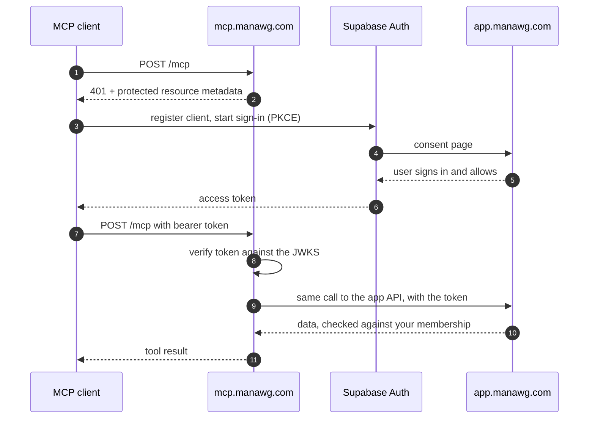

<h1 align="center">ManaWG MCP</h1>

<p align="center">
  Your shared flat, for your AI assistant: expenses, balances, cleaning rota, shopping list,
  supplies, noticeboard, chat and calendar of <a href="https://manawg.com">ManaWG</a>, as tools for
  Claude, ChatGPT, Cursor and every other MCP client.
</p>

<p align="center">
  <a href="#connect-an-agent"><strong>Connect an agent</strong></a> ·
  <a href="docs/tools.md">Tools</a> ·
  <a href="docs/self-hosting.md">Self-host</a> ·
  <a href="#how-it-works">How it works</a> ·
  <a href="CONTRIBUTING.md">Contribute</a>
</p>

<p align="center">
  <a href="https://github.com/Abuarchiv/manawg-mcp/actions/workflows/ci.yml"></a>
  <a href="https://github.com/Abuarchiv/manawg-mcp/releases/latest"></a>
  <a href="https://registry.modelcontextprotocol.io/v0/servers?search=com.manawg/mcp"></a>
  <a href="https://github.com/Abuarchiv/manawg-mcp/pkgs/container/manawg-mcp"></a>
  <a href="LICENSE"></a>
</p>

[ManaWG](https://github.com/Abuarchiv/manawg) is the free, open-source app for shared flats
(*WG*, from the German *Wohngemeinschaft*). This server lets an assistant work with your flat the
way you do in the app: it reads what is due, books what you just paid, puts milk on the list, and
tells you who owes whom.

## Connect an agent

Use the hosted server at **`https://mcp.manawg.com/mcp`**. Your client opens the browser, you
sign in to ManaWG and allow the assistant. There is no key to copy and nothing to install.

| Client | How to add it |
| --- | --- |
| **Claude Code** | `claude mcp add --transport http manawg https://mcp.manawg.com/mcp` |
| **Claude** (web, desktop) | Settings → Connectors → Add custom connector, URL `https://mcp.manawg.com/mcp` |
| **ChatGPT** | Settings → Apps & Connectors → Advanced settings → Developer mode, then Create with the URL and OAuth |
| **Cursor, VS Code, others** | Add a streamable HTTP server with the URL `https://mcp.manawg.com/mcp` |

No ManaWG account yet? Create one and a flat at [app.manawg.com](https://app.manawg.com), or let
the assistant call `wg_create` once you are signed in.

### Things to ask

- *"What is due in the flat this week?"*
- *"I paid 42.80 € for groceries, split it between everyone except Jonas."*
- *"Who owes whom, and what is the smallest number of payments to settle up?"*
- *"Put oat milk and dish soap on the shopping list."*
- *"I'm away from the 12th to the 19th, take me off the cleaning rota."*
- *"Write a friendly reminder for the open balances, but don't send it."*

## What the assistant can do

The assistant acts as your account, in all your flats, with the same rights you have in the app.

- **It can** read everything you can see, create and edit expenses, fixed costs, shopping items,
  supplies, chores, posts, chat messages, events and absences, and settle debts the way the app
  does.
- **It cannot** delete a flat, change your account or sign-in, or move money. ManaWG never moves
  money; settling up only records what you paid each other.
- **The hosted server leaves out all 16 destructive tools**: deleting expenses, posts or items,
  changing flat or member settings, sending reminders and committing imports. Read tools carry
  `readOnlyHint`, so clients can ask before every other call.
- **You stay in control.** Every assistant you connected is listed in the app under
  Settings → Access, and you can disconnect each one there.

The full list of 74 tools, 13 resources and 4 prompts is in [docs/tools.md](docs/tools.md).

| Area | Examples |
| --- | --- |
| Overview | `wg_overview`, `dashboard_get`, `activity_get`, `export_get` |
| Money | `expense_create`, `balances_get`, `settlement_preview`, `cash_payment_record` |
| Fixed costs | `recurring_list`, `recurring_create`, `recurring_advance` |
| Shopping and supplies | `shopping_add`, `shopping_set_bought`, `inventory_consume` |
| Cleaning rota | `chores_list`, `chore_complete`, `absence_create` |
| Noticeboard and chat | `note_create`, `note_comment`, `chat_send`, `chat_unread` |
| Calendar | `events_list`, `event_create`, `event_update` |
| Prompts | `daily_brief`, `shopping_run`, `payment_reminder`, `settlement_plan` |

## How it works



The server is an OAuth 2.1 resource server as the
[MCP authorization spec](https://modelcontextprotocol.io/specification/2025-11-25/basic/authorization)
describes it. Supabase Auth, which already runs the app's sign-in, is the authorization server.
The MCP server stores nothing: it checks each token and forwards it, and the app applies the same
membership checks as for your phone.

Each tool calls exactly one route of the app API. Money is in integer cents, every write carries
an idempotency key so a retried request is never booked twice, and writes that could race with a
flatmate fail instead of overwriting (`chore_occurrence_changed`, `shopping_item_changed`). Errors
come back as a fixed code such as `ManaWG request failed: splits_sum_mismatch`, never with
upstream text or credentials.

## Self-host

Run it on your own machine for a local agent over stdio, behind an API key over HTTP, or as your
own OAuth server in front of your own ManaWG instance.

```bash
git clone https://github.com/Abuarchiv/manawg-mcp.git && cd manawg-mcp
pnpm install && pnpm build
mkdir -p ~/.config/manawg-mcp && cp .env.example ~/.config/manawg-mcp/env
chmod 600 ~/.config/manawg-mcp/env        # then fill in your instance and account
claude mcp add manawg --env-file ~/.config/manawg-mcp/env -- node "$(pwd)/dist/index.js"
```

Or with Docker: `ghcr.io/abuarchiv/manawg-mcp` (`linux/amd64`, `linux/arm64`).

The [self-hosting guide](docs/self-hosting.md) covers both auth modes, every environment variable,
the HTTP transport, Docker and the Vercel deployment behind `mcp.manawg.com`.

## Develop

You need Node.js 22 and pnpm 9. Tests, lint and typecheck need no credentials.

```bash
pnpm lint        # Biome
pnpm typecheck   # tsc --noEmit
pnpm test        # Vitest: flows against a stateful stub app, API surface, OAuth
pnpm build       # compile to dist/
pnpm smoke       # stdio handshake against dist/
pnpm inspector   # MCP Inspector against dist/index.js
pnpm live-check  # read-only probes against a real instance (credentials required)
```

The tests run the real server, client and session code against a stub of the app that enforces
its rules (Origin, cookies, idempotency keys, optimistic locking, strict bodies), and an API
surface check keeps every tool mapped to a route the app actually has.

## Contributing

Issues and pull requests are welcome. Read [CONTRIBUTING.md](CONTRIBUTING.md) and the
[Code of Conduct](CODE_OF_CONDUCT.md) first. Problems with the app itself belong in the
[app repository](https://github.com/Abuarchiv/manawg/issues/new/choose). Report security problems
privately, see [SECURITY.md](SECURITY.md). Changes are listed in [CHANGELOG.md](CHANGELOG.md).

## License

[Apache License 2.0](LICENSE), like the [ManaWG app](https://github.com/Abuarchiv/manawg). The
licence does not grant rights to the name ManaWG or its logo.
